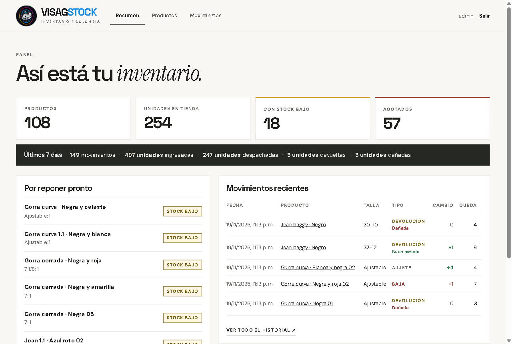
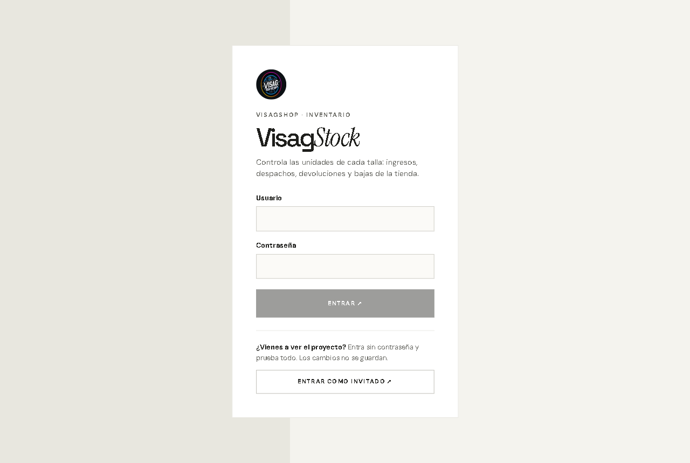
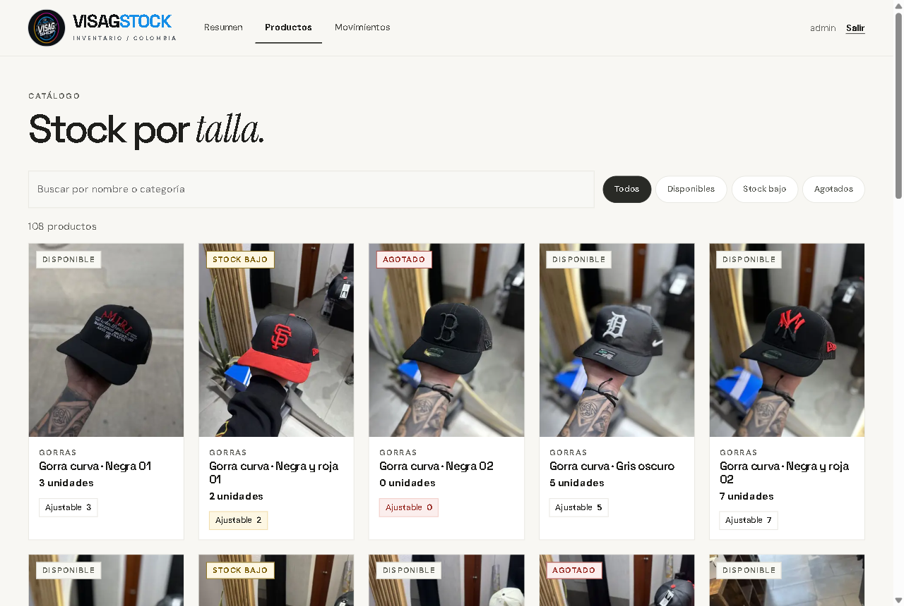
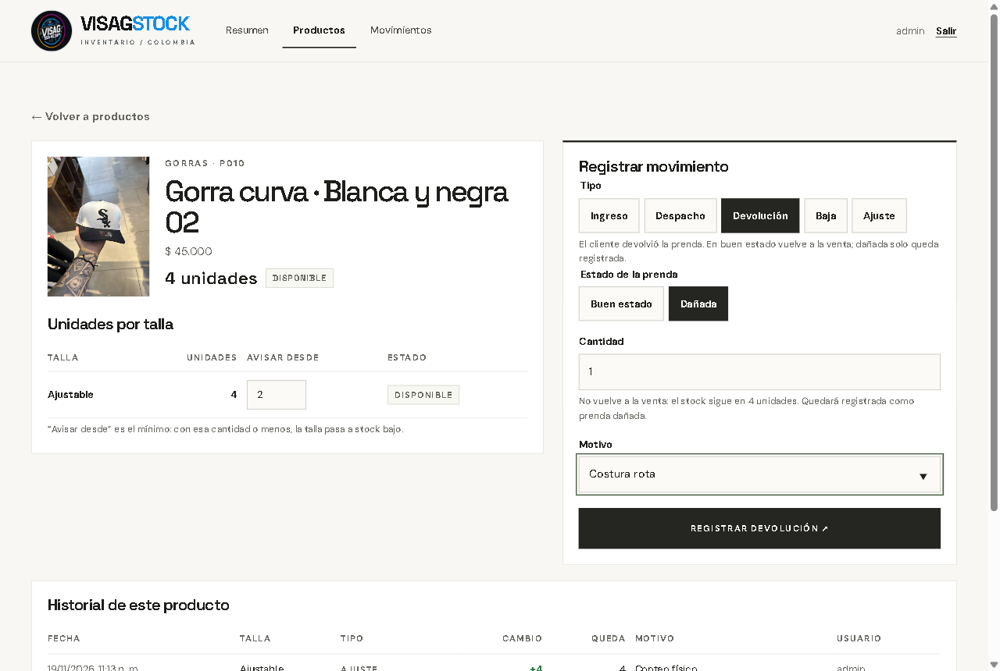

# VisagStock

Inventario por talla para **VisagShop**, la tienda de ropa urbana de Lebrija (Santander).

La tienda en línea sabe qué productos existen y en qué tallas vienen, pero no sabía **cuántas unidades
quedan** de cada talla. VisagStock resuelve eso: lleva la cuenta de cada talla, guarda cada ingreso,
despacho, devolución y baja con su motivo, y avisa cuando algo está por agotarse.

**Pruébalo en línea:** [visagstock.onrender.com](https://visagstock.onrender.com) → pulsa **Entrar como
invitado**. No necesitas contraseña y puedes probar todo; los cambios no se guardan. La primera vez puede
tardar un minuto en abrir, porque el plan gratis de Render duerme el servidor cuando nadie lo usa.



## Qué hace

- **Stock por talla.** Cada producto muestra sus tallas (S, M, L, 28-8, 32-12…) con las unidades que
  quedan. Los productos sin tallas, como algunas gorras, aparecen con la talla **"Única"**.
- **Estados y alertas.** Cada talla tiene un mínimo ("avisar desde"). Con 0 unidades está **agotada**;
  con el mínimo o menos está en **stock bajo**; si no, está **disponible**. El resumen muestra los
  productos que hay que reponer pronto.
- **Cinco tipos de movimiento**, con los nombres que se usan en un kárdex de inventario:

  | Tipo | Qué pasa con el stock | Cuándo se usa |
  | --- | --- | --- |
  | **Ingreso** | Suma | Llegó mercancía del proveedor o del taller. |
  | **Despacho** | Resta | La prenda salió hacia el cliente (venta en tienda, WhatsApp, por mayor, envío). |
  | **Devolución** | Depende del estado | El cliente devolvió la prenda. **En buen estado** vuelve a la venta (suma). **Dañada** *no* vuelve a la venta: el stock no cambia, pero queda registrada como prenda dañada. |
  | **Baja** | Resta | Una prenda que ya no se puede vender y nunca llegó al cliente: dañada, manchada o perdida en la tienda. |
  | **Ajuste** | Lo que se contó | Se escribe cuántas unidades se contaron a mano y el sistema guarda la diferencia. |
- **Historial.** Cada movimiento queda guardado con fecha, talla, cambio, cuánto quedó, motivo y quién
  lo hizo. Se puede filtrar por producto, tipo y fechas.
- **Nunca vende de más.** Si quedan 2 unidades y alguien intenta sacar 3, se rechaza. Esto funciona
  incluso si dos personas registran ventas **al mismo tiempo**.
- **Dos formas de entrar.** El **administrador** entra con usuario y contraseña y sus cambios se
  guardan. El **invitado** entra con un botón, sin contraseña: puede usar todo y el servidor valida y
  calcula cada movimiento de verdad, pero al final lo deshace, así que el inventario real no cambia.

| Entrada (con invitado) | Productos | Detalle y movimiento | Historial en el celular |
| --- | --- | --- | --- |
|  |  |  |  |


## Qué usé y por qué

| Herramienta | Para qué | Por qué la elegí |
| --- | --- | --- |
| **TypeScript** (API y pantallas) | Todo el código | Avisa los errores *antes* de ejecutar: si la API cambia la forma de un dato, la pantalla no compila hasta corregirla. |
| **Node.js + Express 5** | La API | Es lo mismo que usa VisagShop, así que el conocimiento se reutiliza. Express 5 ya maneja los errores de funciones `async` sin código extra. |
| **PostgreSQL (Neon)** | Guardar el stock y los movimientos | Es **la misma base de datos de la tienda**. Las tablas nuevas viven en un esquema aparte llamado `inventario`, para no mezclarse con las de la tienda. |
| **pg** (sin ORM) | Hablar con la base | Las consultas importantes (bloqueos, uniones de tablas) se ven claras en SQL. |
| **Zod** | Revisar los datos que llegan | Una sola regla sirve para validar y para darle el tipo correcto en TypeScript. |
| **JSON Web Token en cookie** | La sesión del administrador | La cookie es `httpOnly` (el JavaScript de la página no la puede leer) y `SameSite=strict` (otros sitios no la pueden usar). |
| **React 19 + React Router** | Las pantallas | Componentes reutilizables (la tabla de movimientos se usa en tres pantallas) y filtros guardados en la dirección de la página. |
| **Vite** | Correr y compilar las pantallas | Arranca en milisegundos y en desarrollo reenvía `/api` al servidor. |
| **Vitest + Supertest + Testing Library** | Pruebas | Prueban la API contra una base PostgreSQL real y las pantallas como las usaría una persona. |
| **GitHub Actions** | Correr las pruebas en cada cambio | Levanta su propio PostgreSQL y revisa tipos, pruebas y compilación. |
| **Render** | Publicarla | Plan gratuito; la API y las pantallas salen en un solo servicio. |

## Cómo funciona por dentro

```
Navegador (React)  ──/api──▶  API (Express)  ──▶  PostgreSQL (Neon)
                                                   ├─ public.products, sizes...  ← tablas de la tienda (solo se leen)
                                                   └─ inventario.existencias      ← unidades por producto y talla
                                                      inventario.movimientos      ← historial
```

- **No se toca la tienda.** VisagStock solo *lee* los productos y tallas de VisagShop y escribe en su
  propio esquema `inventario`. Si se borra un producto en la tienda, su stock se borra solo
  (`ON DELETE CASCADE`).
- **Las tablas se crean solas.** Al arrancar, la API revisa qué migraciones (`api/src/migraciones`)
  faltan y las aplica. Usa un *candado* de PostgreSQL para que dos servidores no lo hagan a la vez.
- **Un solo origen.** En producción la misma API entrega las pantallas compiladas, así que no hace
  falta configurar CORS.

### La API

Todas las rutas empiezan por `/api`. Las marcadas con 🔒 piden sesión.

| Método | Ruta | Qué hace |
| --- | --- | --- |
| GET | `/estado` | Responde `ok` (lo usa Render para saber si está viva) |
| POST | `/sesion` | Inicia sesión (máximo 10 intentos cada 15 minutos) |
| GET | `/invitado` | Dice si la cuenta de invitado está activa |
| POST | `/sesion/invitado` | Entra como invitado, sin contraseña |
| GET / DELETE | `/sesion` | Consulta o cierra la sesión |
| GET 🔒 | `/resumen` | Cifras generales, alertas y últimos movimientos |
| GET 🔒 | `/productos?buscar=&estado=&pagina=` | Productos con su stock por talla |
| GET 🔒 | `/productos/:id` | Un producto y sus últimos 20 movimientos |
| GET 🔒 | `/movimientos?productoId=&tipo=&desde=&hasta=` | Historial con filtros |
| POST 🔒 | `/movimientos` | Registra un ingreso, despacho, devolución (con `condicion`: `buena` o `danada`), baja o ajuste |
| PUT 🔒 | `/minimos` | Cambia el mínimo de una talla |

Si quien hace el cambio es el invitado, la respuesta trae `"simulado": true` y nada se guarda.

## Correrlo en tu computador

Necesitas **Node.js 22.12 o superior** y una base PostgreSQL que tenga las tablas de VisagShop.

```bash
npm install
cp api/.env.example api/.env
```

Llena `api/.env`:

| Variable | Qué es |
| --- | --- |
| `DATABASE_URL` | La conexión a PostgreSQL (la misma de VisagShop) |
| `ADMIN_USERNAME` / `ADMIN_PASSWORD` | Con qué se entra (la contraseña debe tener al menos 10 caracteres) |
| `JWT_SECRETO` | Un texto secreto largo (mínimo 32 caracteres) para firmar las sesiones |
| `DEMO_ACTIVO` | `true` muestra el botón **Entrar como invitado**; con `false` (o sin definir) solo entra el administrador |
| `TEST_DATABASE_URL` | Opcional: un PostgreSQL donde las pruebas puedan crear bases temporales |

Luego, en dos terminales:

```bash
npm run dev:api   # API en http://localhost:4000
npm run dev:web   # Pantallas en http://localhost:5173
```

Otros comandos:

```bash
npm test          # pruebas de la API y de las pantallas
npm run typecheck # revisa los tipos de todo el proyecto
npm run build     # compila las pantallas y la API
npm start         # arranca la versión compilada
```

## Pruebas

- **API (33 pruebas).** Cada ejecución crea una base PostgreSQL temporal con productos de ejemplo,
  aplica las migraciones, prueba y la borra al final. Se revisan la sesión, la cookie, el bloqueo
  de otros sitios, la búsqueda sin tildes, los cinco tipos de movimiento, que una devolución dañada
  quede registrada **sin** volver a la venta, las tallas que no son del producto, los datos mal
  formados y **ocho despachos simultáneos con solo cinco unidades**: se aceptan exactamente cinco.
  También se revisa que el invitado entre sin contraseña, que sus movimientos y mínimos **no se
  guarden** pero sí se validen (no puede despachar lo que no hay) y que no pueda entrar si
  `DEMO_ACTIVO` está apagado.
- **Pantallas (12 pruebas).** El formulario muestra cuánto quedará, no deja despachar ni dar de baja
  más de lo que hay, exige el estado de la prenda en una devolución, envía bien los datos y muestra
  los errores de la API. Con el invitado, el botón dice **Probar** y avisa que no se guarda. También se prueban los textos en español ("queda 1 unidad", "1.200 unidades").

Si `TEST_DATABASE_URL` no está definida, las pruebas de la API se saltan en vez de fallar.

## Render

El archivo `render.yaml` ya trae la configuración. En Render: **New → Blueprint**, se elige este
repositorio y se llenan `DATABASE_URL` (la misma de VisagShop en Neon), `ADMIN_USERNAME` y
`ADMIN_PASSWORD`. El secreto de las sesiones lo genera Render solo y `DEMO_ACTIVO` ya viene en `true`.

En línea: [visagstock.onrender.com](https://visagstock.onrender.com).

## Qué aprendí

1. **Bloquear la fila antes de restar.** Si dos ventas leen "quedan 5" al mismo tiempo, las dos
   restan y el stock queda mal. Con `SELECT … FOR UPDATE` dentro de una transacción, la segunda venta
   *espera* a que termine la primera y lee el número ya actualizado. Lo comprobamos con una prueba que
   lanza ocho ventas a la vez.
2. **`NULL` también puede ser una talla.** Los productos sin tallas se guardan con `talla_id` vacío.
   En SQL dos `NULL` normalmente son "distintos", así que la regla de "una sola fila por producto y
   talla" no funcionaba. `UNIQUE NULLS NOT DISTINCT` (PostgreSQL 15+) y `IS NOT DISTINCT FROM`
   resuelven eso.
3. **Guardar el cambio, no solo el resultado.** Cada movimiento guarda cuánto cambió (`+10`, `-3`) y
   cuánto quedó. Así el historial se entiende solo y un ajuste muestra exactamente la diferencia.
4. **Comparar contraseñas sin dar pistas.** Una comparación normal termina antes cuando la primera
   letra no coincide, y eso se puede medir. Usamos `timingSafeEqual`, que siempre tarda lo mismo.
5. **La misma validación en los dos lados.** La pantalla avisa "solo quedan 2 unidades" antes de
   enviar, pero la API vuelve a revisarlo. La pantalla ayuda; la API es la que manda.
6. **TypeScript en todo el camino.** Los tipos de la API y de las pantallas tienen la misma forma;
   muchos errores aparecieron al compilar y no frente al usuario.
7. **Pensar en el negocio antes que en el código.** Al principio solo existían "entrada" y "salida".
   Pero una prenda devuelta dañada no puede volver a la venta, y una prenda que se daña en la tienda
   no es una venta. Por eso separamos **Devolución** (con el estado de la prenda) y **Baja**. La base de
   datos también lo protege: una devolución sin estado, o un movimiento que no cambia nada (salvo la
   devolución dañada), se rechaza con reglas `CHECK`.
8. **Pruebas contra una base real.** Simular la base no hubiera detectado el problema de los `NULL`
   ni el de las ventas simultáneas. Por eso las pruebas usan PostgreSQL de verdad.
9. **Una demostración que no ensucia los datos.** Para que un reclutador pudiera probar el proyecto sin
   mi contraseña, creé la cuenta de invitado. En vez de escribir un código aparte que "imite" los
   movimientos, uso el mismo código real dentro de una transacción y al final hago `ROLLBACK` en lugar
   de `COMMIT`. Así el invitado ve exactamente las mismas validaciones y cálculos, y la base queda
   como estaba.

## Problemas que tuve y cómo los resolví

| Problema | Por qué pasaba | Cómo lo resolví |
| --- | --- | --- |
| Al compilar, el servidor no encontraba las migraciones. | TypeScript solo copia archivos `.ts`; los `.sql` se quedaban por fuera de `dist`. | El comando `build` de la API ahora copia la carpeta `migraciones` después de compilar. |
| Al entrar en modo desarrollo salía **"Origen no permitido"**. | Vite reenvía `/api` al servidor y cambia el `Host`, entonces la protección contra otros sitios veía un origen distinto. | Se ajustó solo el reenvío de Vite para que use el mismo origen. La API sigue igual de estricta. |
| Las fotos de las tarjetas tardaban en aparecer. | Se cargaba la foto completa (≈32 KB cada una) desde la tienda. | Se usan las miniaturas WebP que la tienda ya tenía (≈6 KB, cinco veces más livianas). |
| En el celular las tarjetas se salían de la pantalla. | En CSS Grid, una columna `1fr` no se encoge más que su contenido, y las tablas la empujaban. | Se cambió a `minmax(0, 1fr)`; ahora las tablas se deslizan de lado dentro de su tarjeta. |
| La base de pruebas local dejó de funcionar ("could not open file"). | Los archivos temporales donde vivía se borraron a medias. | Se creó de nuevo desde cero, y las pruebas crean cada base con `TEMPLATE template0`, que es más resistente. |
| Con todo en cero, el resumen decía "¡Todo en orden!". | Solo se revisaba si había alertas, no si había unidades. | Si no hay unidades, ahora invita a registrar el primer ingreso. |
| Textos con errores: "Ajuste guardada", "quedan 1 unidad". | Se armaban las frases pegando palabras sin revisar género ni número. | Frases completas para cada tipo y una función `quedan()` que concuerda el verbo; tiene su propia prueba. |
| Una prenda devuelta **dañada** volvía a quedar disponible para la venta. | Solo existían "entrada" y "salida": cualquier devolución se registraba como entrada y sumaba al stock. | Los tipos pasaron a nombres de kárdex (Ingreso, Despacho, Ajuste) y se añadieron **Devolución**, que pide el estado de la prenda (en buen estado suma; dañada no suma pero queda registrada), y **Baja**, para prendas dañadas en la tienda. El resumen muestra cuántas unidades se dañaron en la semana. |
| VisagStock no se parecía a VisagShop: tenía la barra negra y acentos verdes que la tienda no usa. | Copié los códigos de color de los archivos de la tienda, pero ahí hay estilos viejos que ya no se ven. Lo que de verdad se ve en VisagShop es neutro: crema, gris y casi negro. | Medí los colores directamente en la tienda en línea, elemento por elemento, y copié cómo usa los colores: encabezado claro con el logo redondo y el nombre como en la página de pago de la tienda (VISAG en negro, STOCK en azul y debajo INVENTARIO / COLOMBIA), fondo crema, textos y botones casi negros, filtros en forma de píldora y ningún verde: solo se usan colores para avisar (ámbar para stock bajo, rojo para agotado). Ahora las dos se ven como parte de la misma marca. |
| En el celular las tablas se cortaban: en el historial no se veían el tipo, el cambio ni lo que quedaba sin deslizar hacia el lado. | Una tabla de 8 columnas no cabe en 360 px; solo se podía ver deslizando, y casi nadie lo nota. | En pantallas pequeñas cada fila se muestra como una **tarjeta** (producto y cambio arriba, talla y lo que queda en medio, fecha abajo) usando solo CSS. Revisé las 5 pantallas en 14 anchos, de 320 a 2560 px, buscando cualquier elemento que se saliera. |
| Revisando eso, una página de prueba "no ocupaba toda la pantalla". | Era la ventana de pruebas automáticas, fijada en 1280 px, no la página. Pero sirvió para ver que en pantallas muy anchas el encabezado y el contenido no estaban alineados. | El encabezado y el contenido ahora comparten el mismo ancho máximo (1320 px), como en VisagShop. |
| En el buscador se borraba el espacio mientras se escribía. | Al actualizar la dirección, el texto se reemplazaba por la versión sin espacios del final. | Solo se reemplaza el texto si de verdad cambió la búsqueda. |
